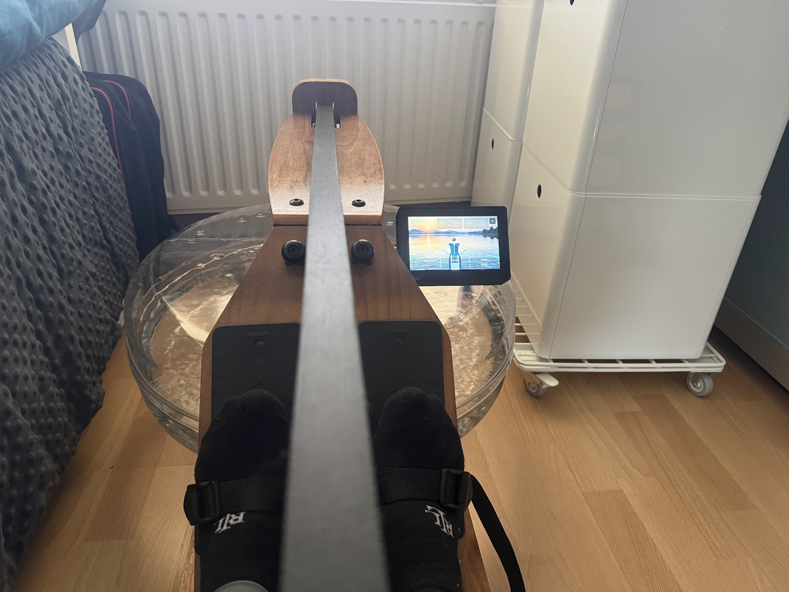

# Rowing Display



ESP32-based replacement console for home rowing machines: a color touch
display that replaces the stock LCD, reading stroke data from the
machine's own flywheel sensor and broadcasting live metrics over Bluetooth
(FTMS) to phones/apps/pace-boat tools, while still working standalone with
no phone present.

Two machines are in scope, each with its own preset (selectable and
tunable on the device under Settings, see Hardware.md):

- **Dunlop Air Rower 750** (air resistance, flywheel/fan)
- **Kuipers AquaRower** (water resistance, paddle-wheel tank)

Two board options, same UI/pipeline on both:

- Waveshare ESP32-S3-Touch-LCD-7 (800×480, dev board)
- Waveshare ESP32-S3-Touch-LCD-5 (800×480, compact)

Both boards have a LiPo battery connector with an onboard charger. The 5"
also has an RTC chip (PCF85063) with a CR927 coin-cell holder to keep the
clock across power cycles (not used by the firmware yet).

## What it does

- Reads the flywheel's reed/Hall sensor and derives rpm, stroke rate,
  drive/recovery phase, split, power, and distance from a flywheel-physics
  model (drag factor fitted per session from the recovery-phase decay).
- Drives an LVGL UI: live metric tiles over a procedurally animated
  stern-view rowing scene synced to the actual drive/recovery phase.
- Notifies live metrics over BLE FTMS (Indoor Rower Data).

See [Hardware.md](Hardware.md) for sensor wiring, board pinouts, and the
physics model's derivation/attribution. See
[firmware/README.md](firmware/README.md) for the firmware source layout.

## Build

Requires [PlatformIO](https://platformio.org/). From the repo root:

```bash
pio run -e esp32-s3-devkitc-1          # 7" board, first boot on the Dunlop preset
pio run -e esp32-s3-devkitc-1-kuipers  # 7" board, first boot on the Kuipers preset
pio run -e esp32-s3-lcd5                # 5" board, first boot on the Dunlop preset
pio run -e esp32-s3-lcd5-kuipers        # 5" board, first boot on the Kuipers preset

pio run -e <env> -t upload              # flash
pio test -e native-test                 # run the metrics-model unit tests

# pull the on-device pulse log after a session
~/.platformio/penv/bin/python scripts/fetch_pulse_log.py --port /dev/cu.usbmodemXXXX
```

## Backgrounds

The scene behind the rower is a photo. One is built in; more can go on a
FAT32 SD card in a `backgrounds` folder (up to 16) and be picked under
Settings > DISPLAY > Background. To make your own from a photo of calm water
(no boat in the foreground), install the image libraries once:

```bash
pip3 install numpy pillow
```

Then:

```bash
python3 scripts/make_background.py my_lake.jpg --name "Home lake"
```

This writes `sd_card/backgrounds/home_lake.bin` and a preview in
`background_previews/`. In the preview the red dashed line must sit where
the far shore meets the water; if it doesn't, rerun with `--horizon 0.52`
(0 = top of the photo, 1 = bottom). `--glint 0` turns off the sun
reflection, and `--out /Volumes/<card>/backgrounds` writes straight to the
card. `python3 scripts/make_background.py --help` lists every option.
`scripts/gen_scene_background.py` rebuilds the bundled set.

## License

This project's own code (`firmware/src`, `firmware/include`, `firmware/test`,
the `platformio.ini` files) is licensed under **GPL-3.0** — see
[LICENSE](LICENSE). Vendored libraries under `firmware/lib/` keep their own
upstream licenses; see [firmware/README.md](firmware/README.md) for details.
