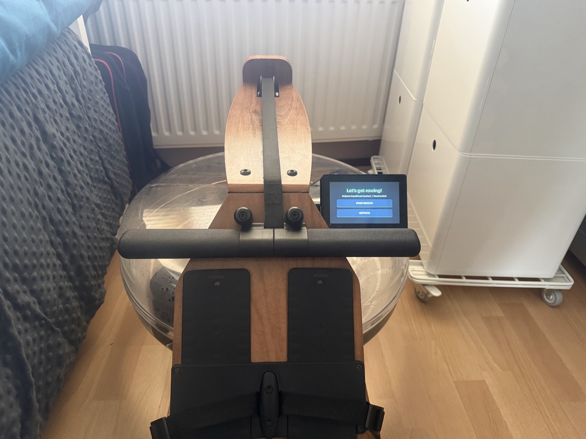
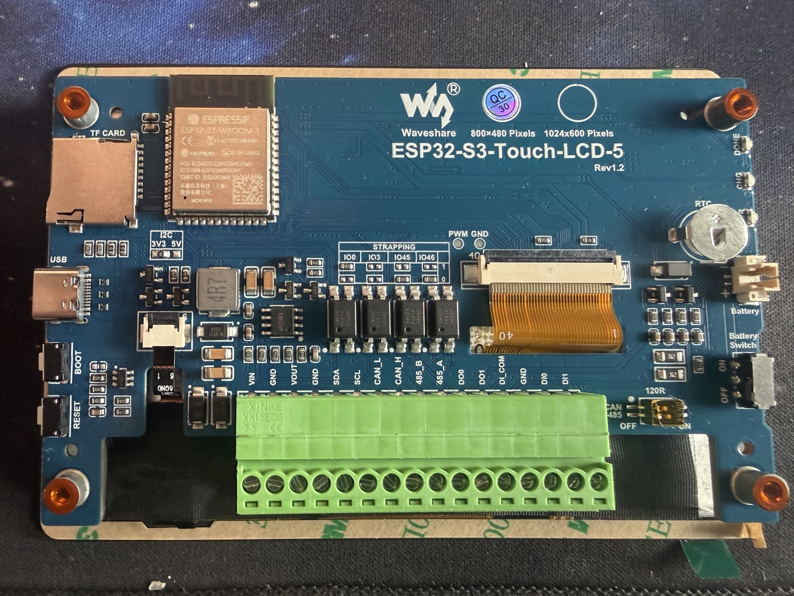
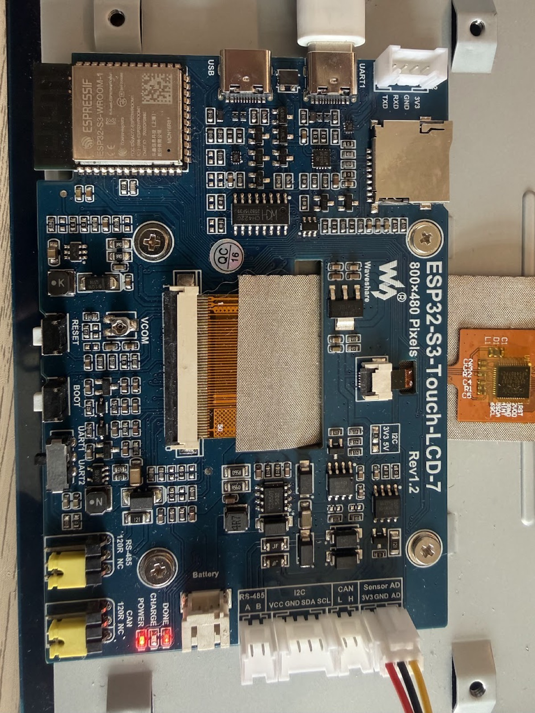
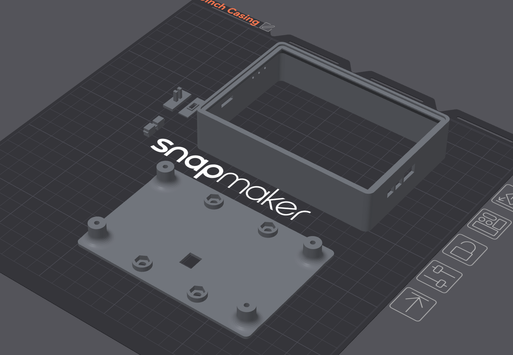
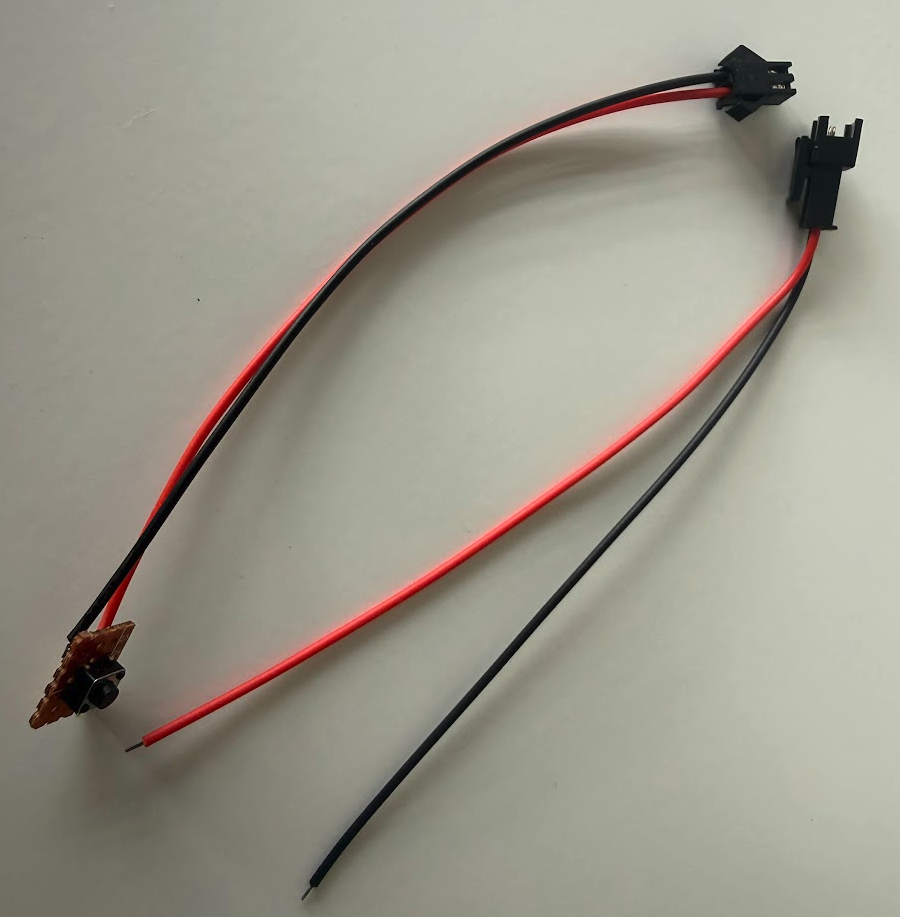
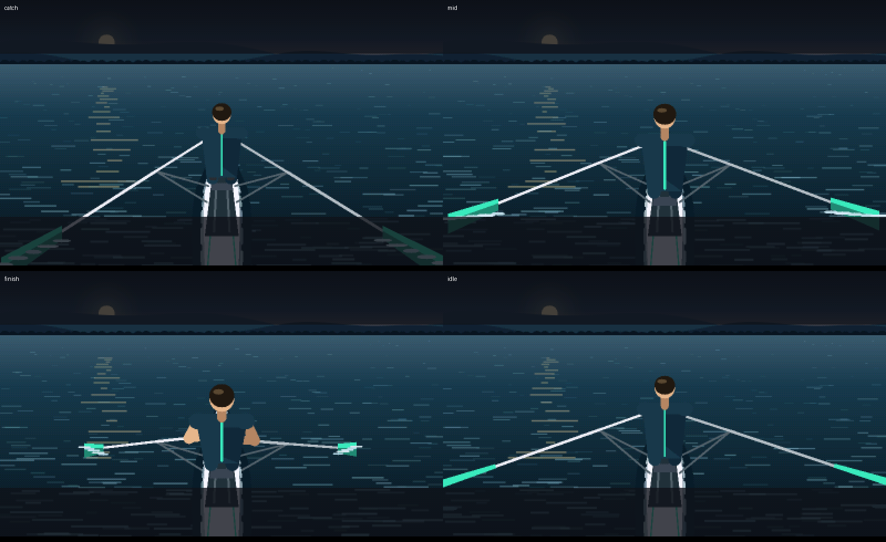
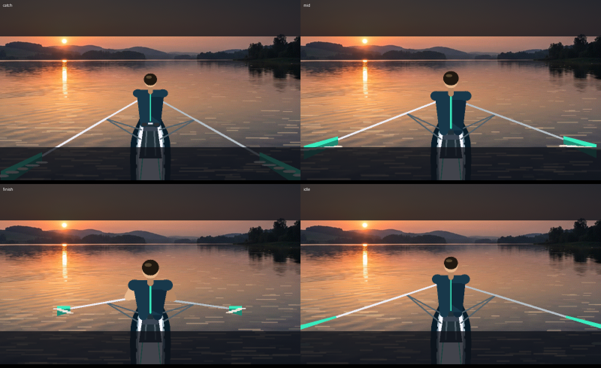
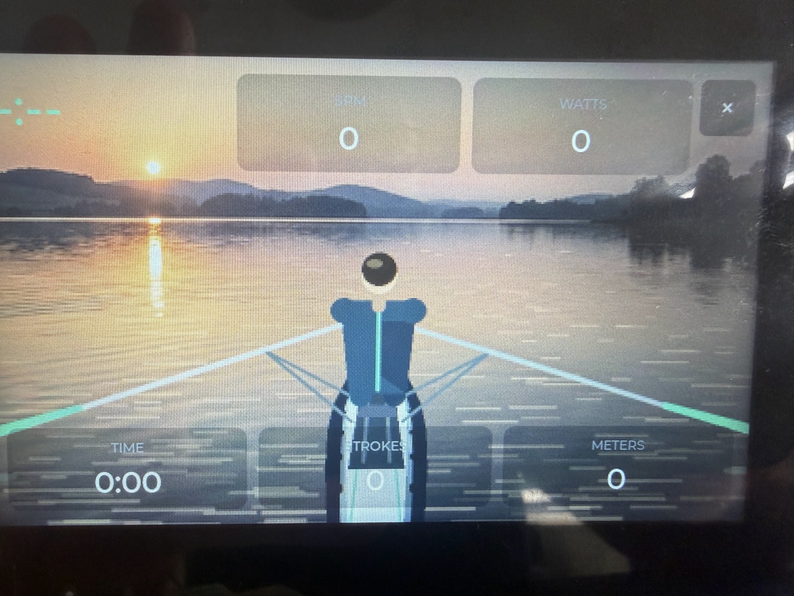
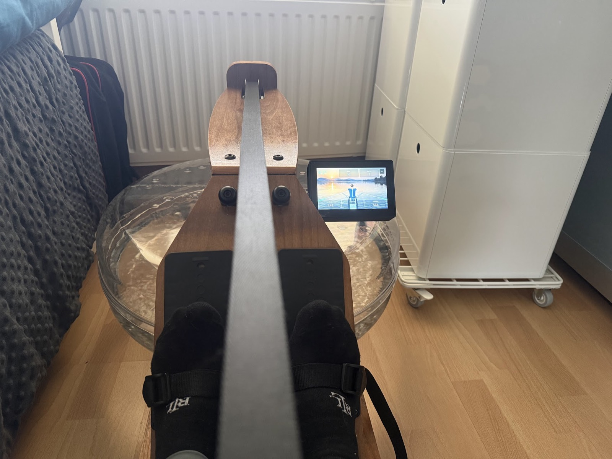

# A new brain for my water rower and my Dunlop Air rower

My Kuipers AquaRower is a lovely machine: wooden rails, a big clear tank, and the sound of water every stroke. Its monitor was the weak spot: a small, low-contrast LCD, and the only way to get data off it was over Bluetooth into the FitShow app. So I built a replacement: a 5" colour touchscreen that reads the rower's own sensor, works out split, stroke rate, watts and distance, and shows a small rower on a lake at sunset who rows along with you.

This post covers how it went: the hardware, the scene, the reed-switch bug that took the longest to fix, and how I calibrated it against the original monitor. My Dunlop Air Rower is next: full support for it, including its own 3D-printed case, is coming in a future release. The firmware, wiring notes and case files are all on [GitHub](https://github.com/mybesttools/Rowing_Display).

## The hardware

The display is a **Waveshare ESP32-S3-Touch-LCD-5**: an ESP32-S3 module with 8 MB of PSRAM, an 800×480 RGB panel, capacitive touch, a battery connector with a charger, and a green screw terminal along the bottom. That terminal matters here. The rower's sensor connects to it directly, so there's nothing to solder.

I started on the 7" version of the same board family, which has a raw GPIO "Sensor AD" header:

I moved to the 5" because the size suits the rower better and the onboard battery most probably will last longer with the smaller screen. Waveshare also sells a 1024×600 variant. I stayed with 800×480 because the ESP32-S3 has to push every pixel out of PSRAM. On a 5" panel seen from a rowing seat, 60% more pixels per frame buys very little sharpness and costs a lot of frame rate.

The case is 3D-printed: a case frame, a backplate with standoffs for the board, a two-part slider that works the board's battery on/off switch through the case, and a double push-button piece for the board's buttons. The STL files are in [`3d_models/`](../../3d_models).

### Bill of materials

| Part | Qty | Notes |
| ---- | --- | ----- |
| Waveshare ESP32-S3-Touch-LCD-5 (800×480, touch) | 1 | ESP32-S3, 8 MB PSRAM, RGB panel, LiPo charger, screw terminal for the sensor |
| 3.7 V LiPo battery, 250 mAh, 2-pin JST plug | 1 | Plugs into the board's `Battery` connector. Check the polarity before plugging in. |
| 2-pin connector pigtail pair (plug + socket, red/black) | 1 | Between the rower's reed lead and the board, so the display unplugs from the rower without unscrewing anything |
| Reed switch | 1 | Acting as the rower's stock sensor, for testing. Both my water rower and air rower have reed contacts. One magnet passes it once per paddle-wheel/flywheel turn. |
| 3D-printed case | 1 set | `5Inch_Model_Case`, `5Inch_Backplate`, `5Inch_Model_Slider`, `5Inch_Model_Slider_Inside`, `5Inch_Double_Push_Button` |
| M5 × 8 mm screw | 4 | Case assembly |
| M5 nut | 4 | For the M5 screws |
| M2.5 × 8 mm screw | 4 | Case assembly |
| USB-C cable | 1 | Flashing and charging |
| CR927 coin cell (3 V lithium, plain button, no solder tabs) | 1 | Clock battery: goes in the board's `RTC` holder and keeps the clock running while the board is fully off |
| microSD card, FAT32 (optional) | 1 | Extra scene backgrounds and saved session files (TCX) |

**Wiring:** reed lead → pigtail → screw terminal **`DI1`** and **`GND`**. The `DI` inputs are optocouplers powered by the board, so nothing goes to `DI_COM`. More on that below.

**Battery:** the board charges the LiPo over USB-C. A small slide switch on the board cuts battery power, and the onboard `CHG`/`DONE` LEDs show charging and full. The firmware can't read the battery level, because neither board connects the charger's status to the ESP32. The LEDs are all you get.

## The scene

Most rowing monitors give you a grid of numbers. I wanted something to look at as well. The display shows a stern view: you're sitting behind a sculler, looking down the lake, and the figure goes through catch, drive, finish and recovery in time with your own stroke.

The first version was fully procedural. Sky, hills, water and rower were all drawn in code:

It worked, but it looked a bit flat. I generated a few photographic dusk-lake backgrounds with Higgsfield, dithered the best one down to 400×240 RGB565, and drew the procedural rower on top of it:

There's a separate write-up of that step in [`higgsfield-background/`](higgsfield-background/README.md).

There's one hard rule on this board: **don't do expensive drawing while the panel is scanning.** The RGB panel reads its framebuffer from PSRAM continuously. If the CPU competes for PSRAM bandwidth at the wrong moment, the image tears, shifts or "shreds". So every animation frame is rendered once at boot (16 stroke frames plus the idle water loop) and kept in PSRAM. While you row, the firmware only picks which frame to show. Startup takes a few seconds longer, and in exchange the animation never glitches mid-session.

## The reed switch that never worked

Like many home rowers, the AquaRower uses a **reed switch**: a magnet on the paddle wheel passes a sensor once per revolution, and you get one pulse per turn. Everything else is derived from the timing between those pulses: wheel speed, how fast it slows down (the drag factor), drive vs. recovery, power and distance.

On the 7" board this was easy: one GPIO and an interrupt. On the 5" board, the input terminals (`DI0`/`DI1`) sit behind a **CH422G I/O expander** on the I2C bus, so the firmware has to poll them. For a long time I simply had no working reed input on any 5" board. In the end there were three separate faults, and all three only became clear after reading Waveshare's own IO example and the schematic side by side:

1. **Wrong read mode.** The CH422G only reports real pin levels when its I/O is in *input* mode. Board init leaves everything as outputs, so every read returned the output latch: a constant `1`.
2. **Bus collisions.** The touch controller sits on the same I2C bus, and touch reads and sensor reads were colliding and timing out. Both now share a short I2C-only lock.
3. **Wrong wiring.** Each `DIx` input is an optocoupler powered by the board itself. The reed has to go from **DIx to GND**, not to `DI_COM`. My notes were wrong, and with them the switch never registered.

Once the pulses arrived, a fourth problem appeared. During a session, drawing a frame of the UI took around 280 ms, and polling from the main loop got starved down to a few reads per second. Sensor polling now runs in its own task on the other CPU core, every 2 ms, and timestamps each edge itself. The next logged session showed about 500 reads per second, a worst-case gap of 4 ms, and no missed pulses.

To debug all of this I added an on-device pulse log: every edge, every pulse handed to the model, and per-second poll statistics are written to a spare flash partition. A small script pulls the log over USB afterwards. Being able to replay a real session through the metrics code on my laptop is what made the next step possible.

## Calibrating against the original monitor

With clean pulses, the numbers were still wrong. Early sessions showed 600–1000 W and meters piling up far too fast. So I did a reference row: two minutes on the original Kuipers monitor (354 m, 59 strokes by my own count), then the same on the new display with the pulse log running.

Replaying that log through the firmware's model showed two things:

- **A lost-stroke bug.** Pulses are timestamped on the polling core, but the model was being ticked with a slightly older timestamp from the main loop. An unsigned subtraction wrapped around, the model decided the rower had gone idle mid-stroke, and the stroke was dropped. After the fix, the replay counted 56 strokes against my 59.
- **Wrong constants.** I fitted the flywheel inertia, the starting drag factor and the boat constant to that session. The replay now gives about 3.0 m/s against the original monitor's 2.95, and a sensible ~80 W at an easy rate.

On the water after that: the stroke count matched mine, about 73 W at 29 spm, roughly 2:50/500 m, and the screen stayed in sync the whole time.

## Settings on the device

The firmware supports both my machines (the Kuipers AquaRower and a Dunlop air rower) and both sensor types (reed and Hall). Rather than rebuilding firmware for every tweak, there's now a **Settings** screen. You pick the machine and sensor preset, and you can adjust magnets per revolution, inertia, drag factor, debounce and so on with +/− buttons. Values are stored in flash, and edited values are highlighted next to their defaults, so it's always clear what you've changed. The settings sit behind a menu of six pages (Machine, Stroke detection, Sensor, Workout, Display, Clock & Wi-Fi), each short enough to fit on the screen without scrolling.

## Phone apps

The old monitor only talked to FitShow. The new display uses **Bluetooth FTMS** (Fitness Machine Service) instead. FTMS is the open standard for gym equipment, so any app that supports FTMS rowers can connect, and you aren't tied to one vendor's app. The display advertises itself as a rower and sends stroke rate and count, distance, live and average pace, average stroke rate, power, calories and elapsed time five times a second. The touchscreen keeps working as usual while a phone is connected.

An app's start, pause, stop and reset buttons now control the session on the display itself: start opens the session screen, pause and stop show a banner, and the display tells the app every change. I tested this end to end from a laptop acting as an app, which also turned up two bugs: the display didn't put its name in its Bluetooth advertisement, so apps would have listed it as an unnamed device, and roughly one data packet in 200 arrived with a corrupted first byte. Both are fixed. Trying the common rowing apps one by one is next.

## Update: backgrounds, session files, a pace boat and a clock

A few things from the "what's next" list are done, plus a couple that weren't on it.

**Your own backgrounds.** One lake is built in; more go on a microSD card in a `backgrounds` folder and can be picked under Settings. A small script turns any calm-water photo into a background file: it guesses the waterline from the reflection (the row the picture mirrors itself best around) and writes a preview so you can check it. The card is only read at boot, because on the 5" board the SD card's chip select sits on the same I/O expander as the sensor input, which runs in input mode while you row.

**Session files.** When a session ends, it's saved to the card as a TCX file, one data point per second with distance, stroke rate and watts. The files pass Garmin's schema check and can be uploaded to Strava, Intervals.icu or Garmin Connect (set the type to rowing after uploading). To reach the card mid-run, the firmware briefly pauses sensor polling and switches the expander back to output mode; saving takes about five seconds.

**Averages and calories** on screen too: an "avg" line under the split and a calories tile, using Concept2's estimate.

**A pace boat.** Set a target split and a translucent sculler rows it in the lane next to you, with a label showing how many metres you're ahead or behind. One lesson: the camera sits behind your stern and sees too narrow a cone to show a boat that's really level with you, so the ghost is drawn six metres further ahead than it is. Level means just past your bow, and the label keeps the true gap.

**A clock.** The board has a real-time clock chip with a coin-cell holder (that's the CR927 in the parts list). The display sets it over Wi-Fi once a week and switches the radio off again after a few seconds, because Wi-Fi traffic competes with the screen for memory bandwidth and visibly shifts the picture. Session files are named in your local time zone. The coin cell's voltage isn't wired to anything the processor can read, so the display can't warn about a flat cell directly. What it can see is that the clock chip stopped after having been set, and then it shows "clock battery?".

## What's next

### The Dunlop Air Rower

- The firmware already has a preset for my Dunlop Air Rower 750, which also uses a reed contact, but that preset isn't calibrated yet. A future release will include a calibrated Dunlop preset plus 3D-print designs for a case and mount that fit the Dunlop.

### Better app support

- Test against the common FTMS rowing apps (Kinomap, EXR and others) and fix whatever each one trips over.

### Heart rate

- Pair a Bluetooth chest strap directly with the display, show heart rate on screen, and pass it on to apps over FTMS. Then you don't need a phone in the loop just to see your pulse.

### Workout history without a phone

- Upload the saved TCX sessions over Wi-Fi to Strava or Intervals.icu, and update the firmware over Wi-Fi as well.

### A small companion web page

- A browser page using Web Bluetooth to change settings and pull session history, so there's no app store involved. This works in Chrome on Android and desktop. iPhones would need a native app or a Web Bluetooth browser, because Safari doesn't support it.

### Hardware and visuals

- **A Hall sensor** to replace the stock reed switch. It's cleaner and doesn't bounce.
- **Smoother animation.** More stroke frames won't fit in PSRAM, so the next gain has to come from making each frame cheaper.
- **More workouts on the device:** intervals and target distances, building on the pace boat.

## Get the code

Everything is on GitHub: **[mybesttools/Rowing_Display](https://github.com/mybesttools/Rowing_Display)**. The firmware is GPL-3.0, and the repo has build instructions, the wiring notes in `Hardware.md`, and the STL files for the 3D-printed case.
